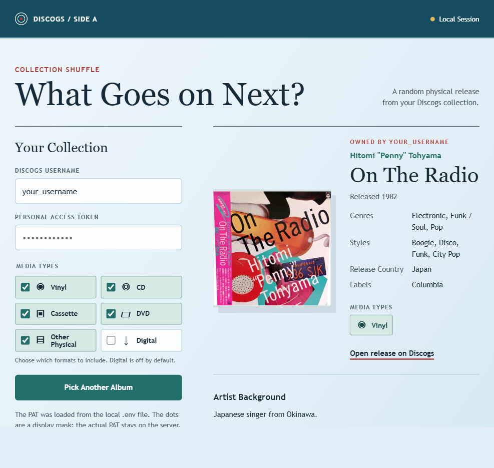

# Discogs Album Picker

Choose a random release from your Discogs collection, filtered by formats you own. The result includes artwork, track positions and durations, release
date, genres, styles, release country, labels, and a short linked artist background when available. Non-square artwork is not cropped; missing artwork
can fall back to the master release without changing the selected collection release.

Only the personal token owner's Collection is eligible. Wantlist entries and public catalogue results are never selection sources. Every pick is
rechecked against a live collection instance before it is returned; failed ownership checks do not fall back to cached or unrelated releases.



The screenshot uses an example username. No personal access token is included in the image.

## Requirements

- Python 3.15 or newer for the coursework environment. The backend uses only the Python standard library.
- A Discogs account with collection entries and a personal access token.
- Internet access for the Discogs API and cover images.

## Get a Discogs Token

1. Sign in to [Discogs](https://www.discogs.com/).
2. Open **Settings**, then **Developers**, or visit [Developer Settings](https://www.discogs.com/settings/developers).
3. Generate a new personal access token. Keep it private; this app does not need an OAuth consumer key or consumer secret.
4. Note your Discogs username, which is not necessarily your email address or display name.

## Configure the App

Create a file named `.env` **in this app folder, beside `app.py`**:

```dotenv
DISCOGS_USERNAME=your_username
DISCOGS_PAT=replace_with_your_personal_access_token
```

The Python server reads this file automatically at startup; no dotenv package is needed. The fork's `.gitignore` excludes `.env`, so the server can
read it locally without committing it. Process environment variables take precedence over file values. Keep the token out of screenshots, shell
history, prompt logs, and version control.

Verify exclusion from the fork root without printing the secret:

```bash
git check-ignore discogs_album_picker/.env
git ls-files -- discogs_album_picker/.env
```

The first command should print the path; the second should print nothing. Ignore rules do not untrack a file already committed, and they are not
encryption. Revoke and replace any exposed token through Discogs.

Alternatively, leave `DISCOGS_PAT` unset and enter a token in the app. A manually entered token stays in the current page for repeat picks and is not
saved to browser storage. When a server-side token is configured, the token field is disabled with an arbitrary dot mask; the actual token stays on
the server. The page identifies whether it came from the local `.env` or process environment.

## Run

From the coursework repository root, initialize the normal environment if necessary and launch the apps:

```bash
uv sync
make hw8
```

Open the printed Discogs URL, normally <http://127.0.0.1:8768/>. To launch only Discogs from the repository root:

```bash
uv run --no-sync python assignments/hw8/fork/discogs_album_picker/app.py --port 8768
```

For a standalone copy with Python 3.15+ selected, run `python app.py --port 8768` from this folder. Use the Python app, not an HTML-only preview.

After changing `.env`, restart only the Discogs server. `make hw8` deliberately reuses a running server; it does not reload credentials or restart it.

## Pick a Release

1. Confirm the username and configured-token source, or enter your credentials manually.
2. Wait for the collection formats to load. Absent formats are hidden, and Digital starts unchecked.
3. Leave the desired formats checked and select **Pick an Album**. For cassettes only, uncheck every other format.
4. Read the selected release and tracklist or follow its Discogs link.

Changing a format or account clears the displayed release and cancels pending picks, so an older result cannot appear under new filters. The result
identifies its collection owner. The entered username must match the token owner's account; other public collections are rejected.

Vinyl covers both LP and other vinyl categories internally. Bundled CD/DVD releases count as DVDs too. Collection scanning covers every page and uses
a short-lived cache; metadata failures do not replace the selection with an unrelated release. Artist background comes from Discogs, not a guessed
hometown. Release country describes the edition, not necessarily the artist's origin.

Checked formats are inclusive: a CD/DVD bundle matches CD or DVD when either is checked. A fresh ownership response must still match at least one
checked format, including LP under the combined Vinyl choice.

## Troubleshooting and Safety

- Empty results: confirm the username, collection contents, and selected formats.
- A release you no longer physically own: check whether Discogs still lists it in **Collection**, not just **Wantlist**. The app cannot determine
  physical possession independently of that record; remove obsolete Collection entries in Discogs.
- Ownership-verification error: wait and retry. The app deliberately selects nothing if account identity or live collection membership is unavailable.
- HTTP 401/403: check or regenerate the token; restart after updating `.env`.
- HTTP 429: wait before retrying; Discogs rate limits apply.
- Missing art, dates, locations, or tracks: Discogs may not supply them for that exact edition.
- Port occupied: choose another `--port`, or use `make hw8 HW8_DISCOGS_PORT=8767`.

The dedicated server binds to loopback and does not serve `.env` or arbitrary files. Do not serve a directory containing credentials with a generic
static file server: hidden files and Git-ignored files can still be downloadable. Loopback limits network reachability; it is not user authentication.
This is a school project limited to the authenticated account's own collection.
