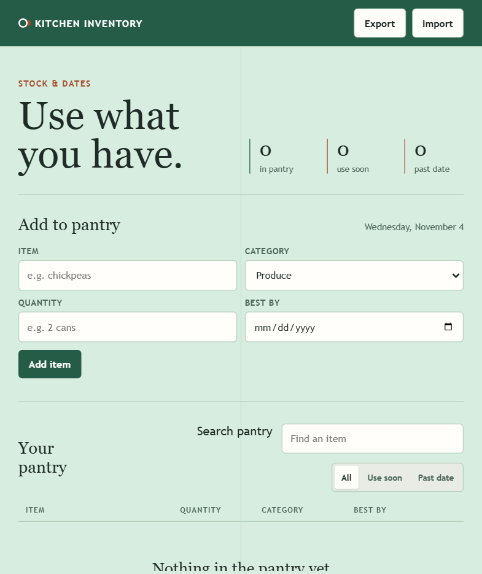

# Pantry Tracker

A local pantry inventory for tracking items, categories, quantities, and best-by dates. Search the inventory, filter items that need attention, edit
or mark items used, and export or import a JSON backup. Green, orange, and red indicators distinguish inventory and date states.



## Setup

This app is one HTML file with no build step or external packages. A current browser is sufficient. For a stable browser-storage origin, use a local
server rather than moving between file URLs and different ports.

From the coursework repository root:

```bash
make hw8
```

Open the Pantry URL printed by the launcher. New Pantry-only servers use <http://127.0.0.1:8769/pantry_tracker.html>; an existing compatible server
may use <http://127.0.0.1:8769/pantry_tracker/pantry_tracker.html> instead.

To run it independently, use Python's standard-library static server from this app folder:

```bash
python -m http.server 8769 --bind 127.0.0.1 --directory .
```

Then open <http://127.0.0.1:8769/pantry_tracker.html>. Serve only this folder, not a parent folder containing other apps' credentials. If the port is
occupied, select another port, or use `make hw8 HW8_PANTRY_PORT=8773` from the coursework root.

## Use

1. Enter an item name, category, quantity, and optional best-by date, then select **Add item**.
2. Search by item and use **All**, **Use soon**, or **Past date** to narrow the inventory.
3. Use each row's controls to edit, mark used, or remove an item.
4. Use **Export** for a JSON backup and **Import** to restore an inventory.

## Storage and Safety

Inventory is stored in this browser's local storage, not on the Python server. Clearing site data, changing browser profiles, or switching ports can
make the inventory appear empty. Export a backup before changing origins or clearing storage. Imports and exports are local files; there is no account
or cloud synchronization.

Best-by dates are reminders, not a food-safety guarantee. Check packaging and use your judgment. This is a school project.
