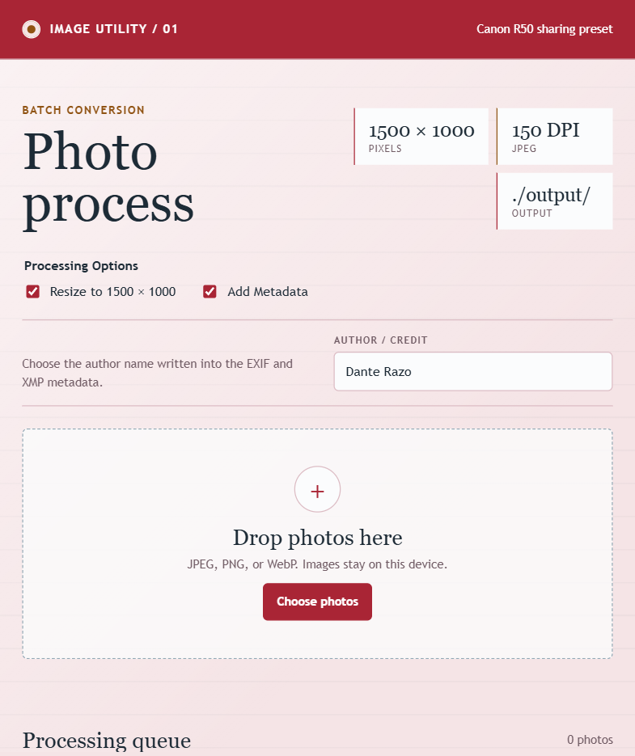

# Photo Process

A local batch JPEG converter with a Canon R50 sharing preset. Resize and metadata are independent options, both checked initially. Add JPEG, PNG, or
WebP images, choose attribution when metadata is enabled, and process the batch. Original files are never modified.



## Setup

The save-enabled app requires Python 3.15+ and uses only the standard library. From the coursework repository root:

```bash
uv sync
make hw8
```

Open the Photo Process URL printed by the launcher, normally <http://127.0.0.1:8771/>. To run only this app from the repository root:

```bash
uv run --no-sync python assignments/hw8/fork/photo_process/app.py --port 8771
```

For a standalone copy with Python 3.15+ selected, run `python app.py --port 8771` from this folder. If the port is occupied, use a different `--port`,
or `make hw8 HW8_PHOTO_PORT=8772` from the coursework root. No Discogs token or other credential is needed.

## Processing Options

| Option                | Checked                                                            | Unchecked                                        |
| --------------------- | ------------------------------------------------------------------ | ------------------------------------------------ |
| Resize to 1500 x 1000 | Fit the whole image on a white 1500 x 1000 canvas without cropping | Keep the source image dimensions                 |
| Add Metadata          | Add the author, copyright, EXIF/XMP fields, and 150-DPI setting    | Omit those added tags and the forced DPI setting |

Metadata starts checked by default. Its author/credit field defaults to `Dante Razo` and is editable. When metadata is unchecked, that field is
disabled and a blank author does not block processing. File names and result labels follow the chosen settings.

All outputs are JPEGs, including when resizing is off. Browser JPEG encoding can retain basic format headers; **Add Metadata** controls this app's
additional tags, not byte-for-byte preservation of source metadata. Existing source metadata is not copied through the canvas conversion. Transparent
areas become white. This is not a RAW/CR3 converter.

## Save and Download

1. Choose photos or drop supported files onto the app.
2. Set Resize and Add Metadata independently.
3. Select **Process photos**.
4. The local server saves each successful result to `output/` beside `photo_process.html`; the result row shows its saved path.
5. Use **Download JPEG** for an additional browser download when needed.

Duplicate names receive `-2`, `-3`, and later suffixes rather than overwriting earlier outputs. The server accepts generated JPEGs up to 10 MB, keeps
writes inside the app's output folder, and rejects foreign-origin save requests. Generated output files are ignored by Git.

A static or direct-file preview can still convert and download images, but cannot automatically write beside its HTML. Check the displayed output
destination: `./output/` means local-server saving is active; `Downloads` means browser-download mode. Images are processed in the browser; saving
sends only the generated JPEG to the local loopback server, not a cloud service.

## Troubleshooting and Safety

- Save error: check output-folder access, available disk space, and the 10-MB output limit.
- Unsupported input: use JPEG, PNG, or WebP rather than a camera RAW file.
- Attribution missing: confirm **Add Metadata** is checked and the author field is filled in.
- Original-size output: confirm **Resize to 1500 x 1000** is checked if you wanted the sharing preset.

Use only images you have permission to edit. Attribution is user-provided and does not establish ownership. This is a school project.
